# Switchboard architecture

Diagrams of how Switchboard is put together and how a request moves through it. GitHub renders the Mermaid blocks below.

## 1. System overview

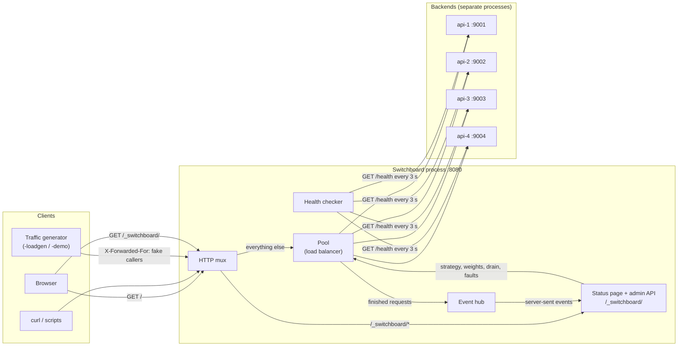

## 2. Packages

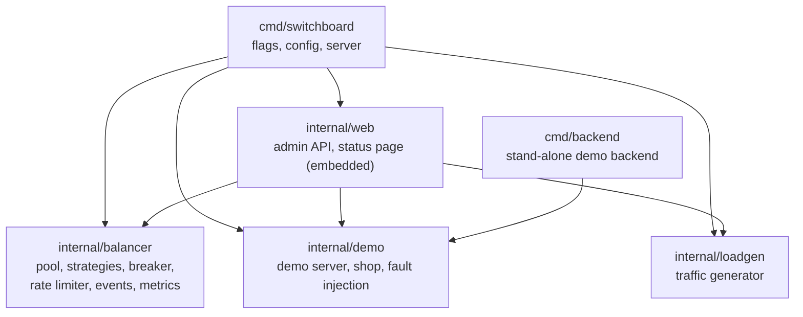

`internal/balancer` depends only on the standard library. Nothing imports `cmd/*`.

## 3. Core types

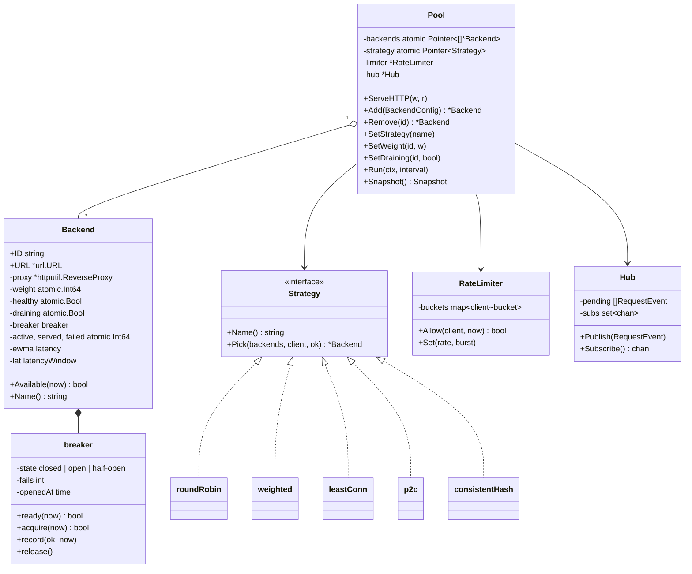

## 4. Life of a request

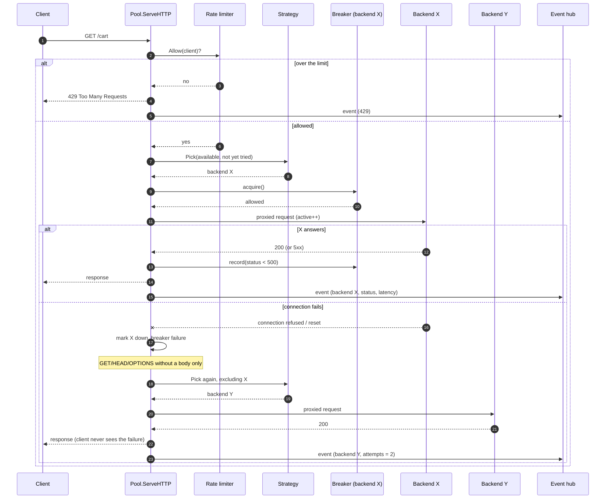

## 5. Request handling decisions

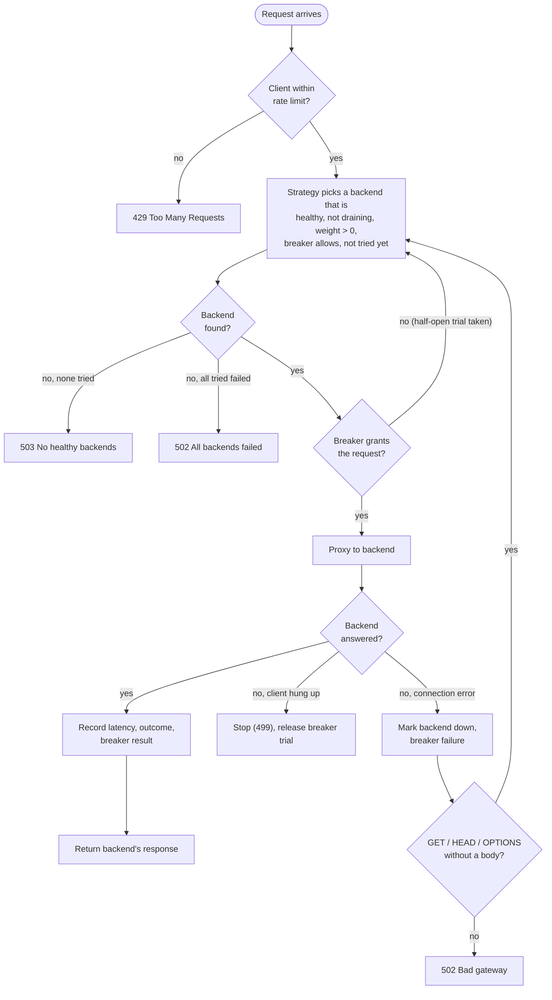

## 6. Circuit breaker

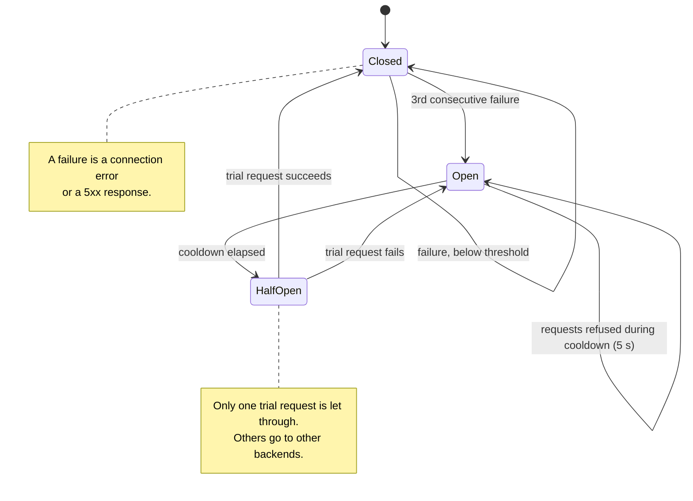

## 7. Backend availability

A backend takes new requests only if every condition holds.

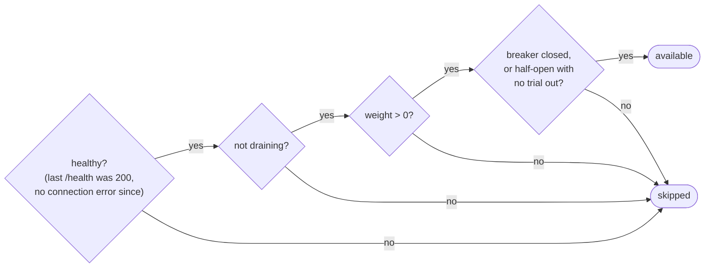

## 8. Health checks

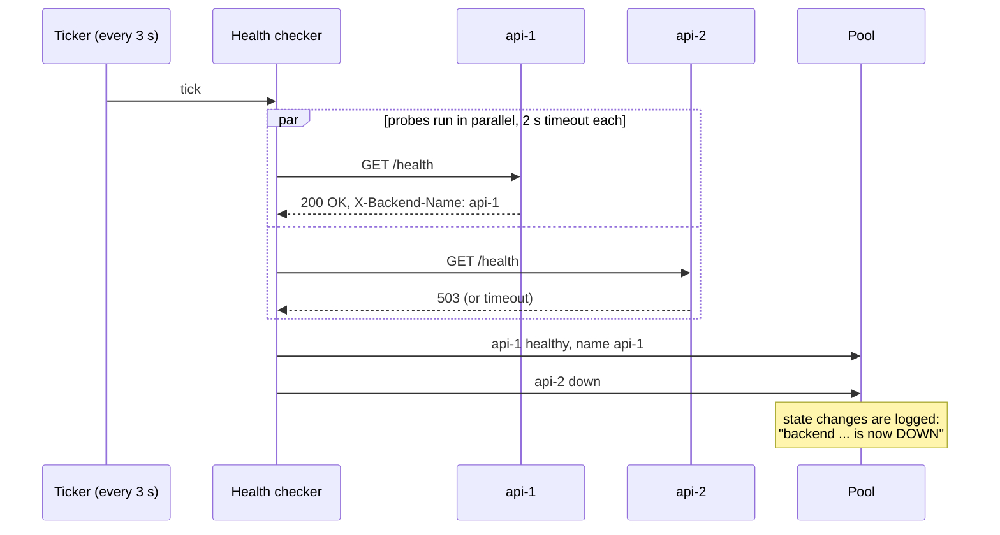

## 9. Strategies

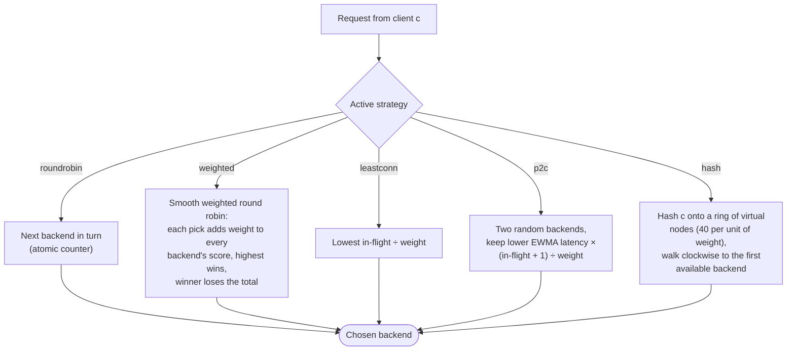

Smooth weighted round robin with weights 5, 1, 1 for a, b, c gives `a a b a c a a`: the heavy backend gets its share without receiving five requests in a row.

## 10. Consistent hashing

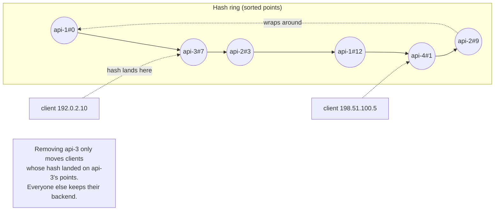

## 11. Rate limiting (token bucket per client)

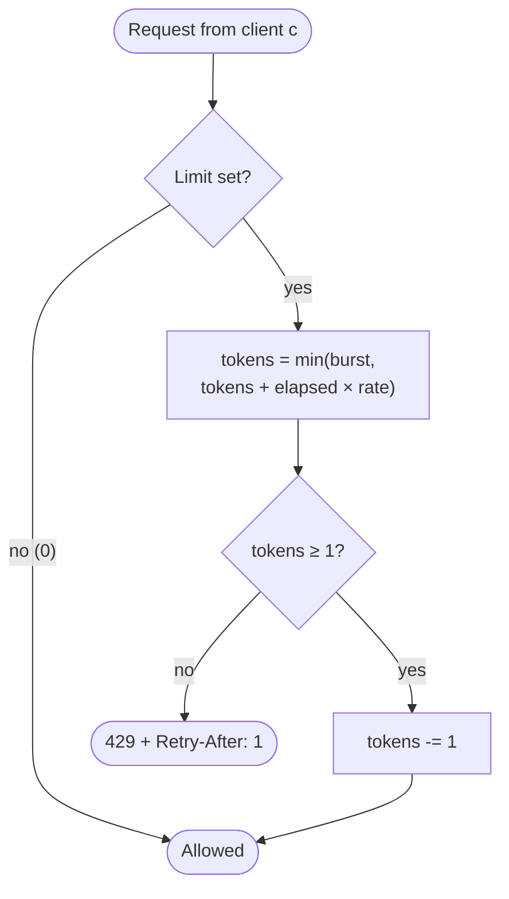

Buckets idle for more than a minute are dropped, so memory stays bounded.

## 12. Changing backends at runtime

The backend list is copy-on-write. Requests read it without a lock; changes build a new list and swap a pointer.

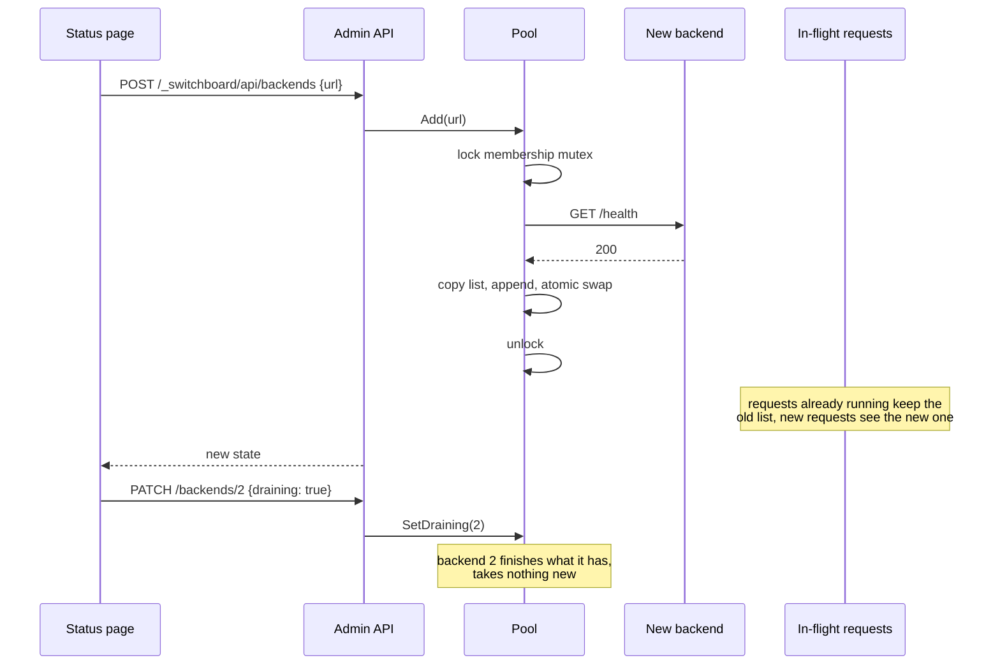

## 13. Live status page

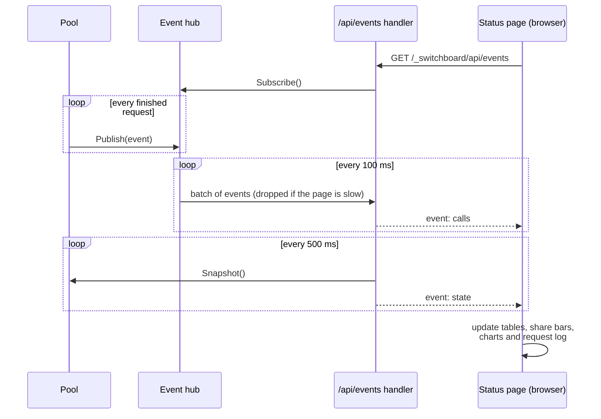

## 14. Fault injection

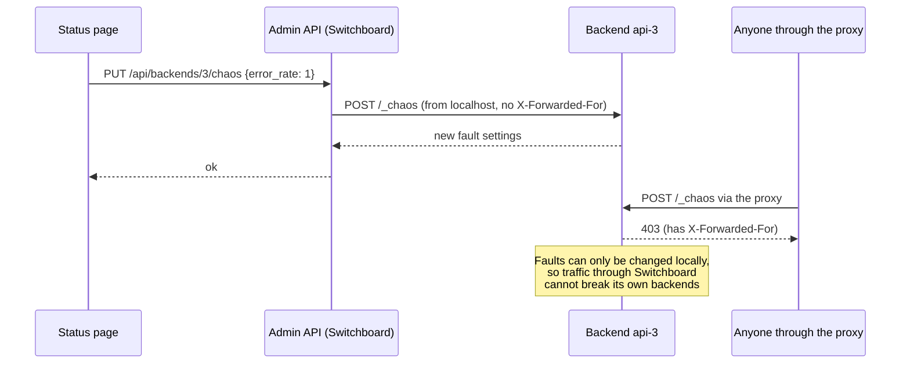

## 15. Shop cart across backends

The demo shop keeps the cart in a cookie, so any backend can serve any page.

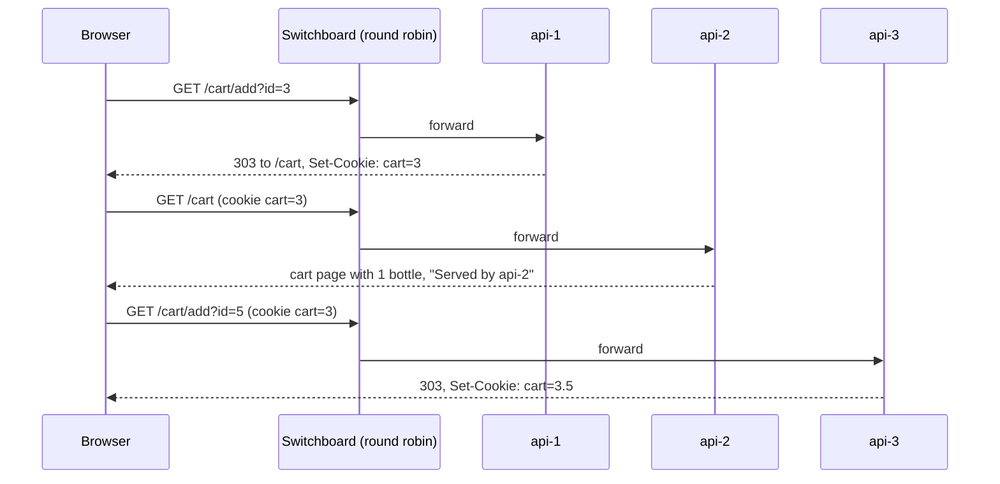

## 16. Local deployments

Two independent deployments run side by side on one machine.

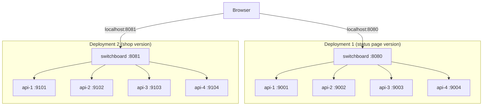
